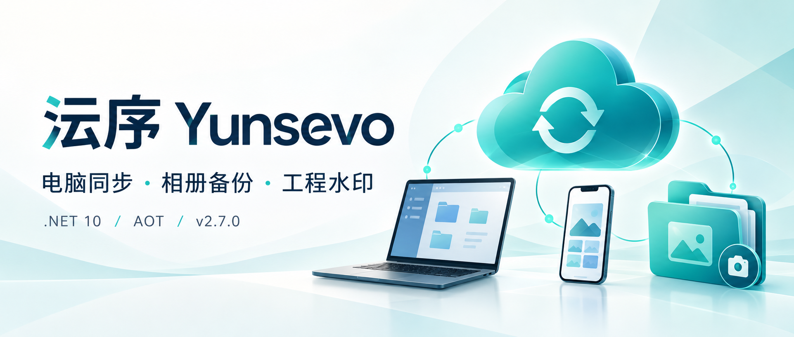
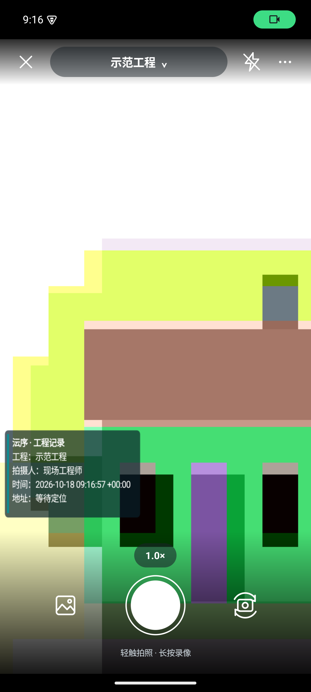
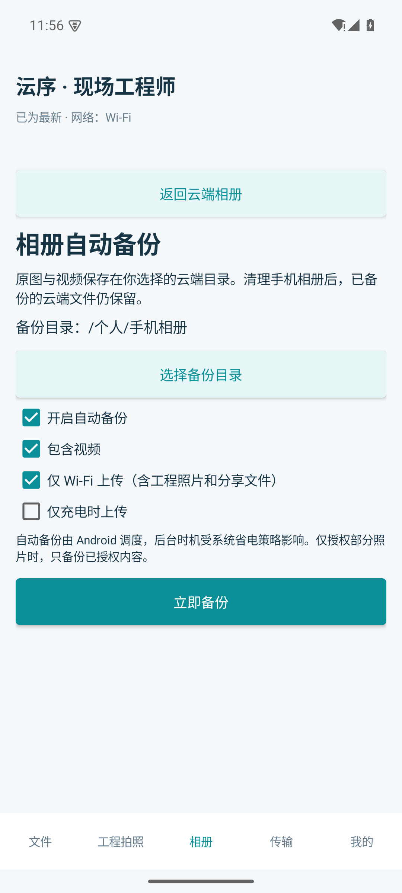
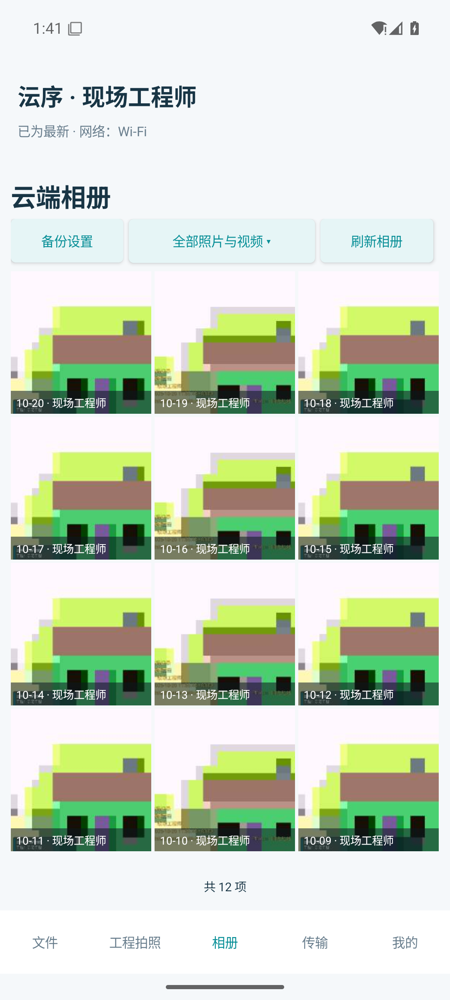

# 用 .NET 10 做一套文件云：电脑同步、相册备份、工程水印拍照都有了



工作资料放在电脑里，现场照片留在手机上，团队共享文件靠来回发送。等到换一台设备，或者需要找回某个旧版本，整理文件往往比处理文件本身更费时间。

我想把这几件事接起来：电脑上的目录能够同步，浏览器能管理文件，手机拍完工程照片就能归档到对应项目。

于是有了 **沄序文件云 · Yunsevo**。

目前已经发布 **v2.7.0**，包含服务端、Windows / Linux / macOS 客户端，以及 Android 1.4.0。


*图 1：网页文件管理，支持目录浏览、上传、下载、预览与版本管理。本文截图使用演示账号和测试资料；手机相机画面来自模拟器测试场景。*

## 01｜电脑端：登录一次，把需要的目录同步起来

桌面端采用的是“先登录，再添加同步任务”的流程。

一台电脑可以连接多个服务器，每个服务器下面也可以添加多个同步目录。例如，个人工作资料同步到笔记本，团队共享资料同步到办公电脑，不同任务分别暂停、继续和管理。

登录状态会加密保存在本机，下次打开客户端时自动恢复。


*图 2：任务按服务器分组，云端目录、本地路径和运行状态放在一起展示。*

Windows 端支持资源管理器里的**按需下载**：文件先以占位文件显示，打开时再获取内容；需要出差使用的资料，可以选择保留在本机，用完后再释放本地空间。

Linux 和 macOS 使用相同的桌面界面，目前同步完整的本地副本。三种系统都提供托盘或菜单栏入口，方便查看状态、打开目录和暂停任务。


*图 3：托盘面板显示任务状态与最近文件活动，也能直接进入网页和同步日志。*

文件删除也区分在线与离线场景。任务在线运行时，删除会同步到云端回收站；如果是在退出、暂停或断线期间删除，重新连接后会让用户选择“也删除云端”“仅本地删除”或“稍后处理”。

## 02｜服务端：把文件、权限和容量一起管理

网页端提供文件管理、用户、用户组、服务设置、回收站和审计日志等独立菜单。

文件夹可以设为个人私有、公共目录，或者只分配给指定的用户与用户组。每个账号自带个人目录，客户端统一显示为 `/个人`；网页管理员可按管理权限访问个人目录，桌面客户端中的管理员账号仍不能查看他人的个人目录。

文件夹还可以设置容量和版本保留策略。例如：给某个项目分配 **10 GiB**，保留最近 **3 个版本**，其中包含当前版本。


*图 4：同一个设置面板里，可以配置目录访问范围、读写权限、容量和保留版本数。*

容量统计包含当前文件、历史版本和回收站，方便了解空间究竟用在哪里。删除后的文件可以从回收站恢复，也可以直接预览或下载。

回收站会记录删除时间、操作用户、设备名称和访问来源；设备名称由客户端上报。配合审计日志，管理员可以追查文件操作记录。


*图 5：回收站保留删除来源，支持下载、恢复和预览。*

需要换服务器时，管理员可以从网页导出迁移备份，包含文件、历史版本、回收站、用户权限和相关配置；恢复工具会检查文件长度与 SHA-256，再恢复到新目录。

## 03｜手机端：工程照片拍完，就进入对应项目

Android 端除了文件浏览，还加入了工程水印相机。

使用时先选择工程目录，比如“设备巡检”或“某某项目”，填写施工部位和备注，再进入拍摄界面。拍摄过程中也可以切换工程，新照片按拍摄时选择的目录入队上传。

相机支持点击对焦、双指缩放、前后摄像头切换，以及横竖屏拍摄。轻触快门拍照，长按录像。



*图 6：相机中可以切换工程，水印展示项目、拍摄人、时间及已启用的附加信息。图中为模拟器取景画面。*

水印提供工程卡片、简约文字和横幅记录等样式，可以选择底色、字体颜色和大小。定位取自手机授权的位置，详细地址和天气通过服务端配置的服务商查询；没有定位结果或网络不可用时，会显示对应状态。

照片处理会尽量保留原始拍摄信息，包括机型、曝光时间、光圈、ISO、焦距和拍摄时间。保存方式也可以选择：**云端＋本机相册**，或者**仅云端**。仅云端模式会在上传成功后清理应用内的临时拍摄文件。

已有照片能在 App 中缩放查看、左右滑动切换，保存到手机或直接分享。其他应用分享过来的文件，也可以选择云端目录后上传。

## 04｜相册备份：手机清理空间，云端保留一份

相册自动备份可以指定云端目录，并选择是否包含视频、是否仅使用 Wi-Fi、是否只在充电时上传。



*图 7：选择备份目录后，可以按网络、充电状态和媒体类型控制上传。*

手机删除已经备份的照片后，云端副本仍然保留。云端相册优先加载小缩略图，滚动时继续加载更多内容，点开照片后再查看详细内容。



*图 8：App 中的云端相册列表。演示素材来自模拟器相机，照片以网格展示，并标注日期和拍摄人；点击后可以缩放查看、左右切换、保存或分享。*

后台备份由 Android 调度，实际执行时机会受到相册授权和手机省电策略影响。

## 05｜技术实现：.NET 10、跨平台界面与 AOT

这套系统主要使用以下技术：

- **服务端**：ASP.NET Core / .NET 10，提供网页管理、文件接口、权限、版本和审计。
- **桌面端**：Avalonia，共用 Windows、Linux、macOS 的界面与任务管理流程。
- **Windows 按需下载**：Cloud Files API，提供资源管理器中的占位文件。
- **Android**：.NET 原生 Android、Camera2 与 Mono AOT。
- **部署**：服务端、桌面端和无界面客户端使用 Native AOT；独立 SMB 网关采用自包含托管 .NET。

同步部分实现了连接复用、变更通知、受控并发、分块续传和范围下载。对于大文件和多文件，目标是减少重复传输，并让单个文件的错误能够单独处理。

服务端还可以按需启用 WebDAV、FTP、SMB。已有的 GLB 模型可以在网页和 Android 中旋转、缩放、环绕查看；当前版本已经移除三维扫描和模型生成功能。

## 06｜下载运行，或者从源码开始

这次 v2.7.0 提供 **22 个安装包**：Windows、Linux、macOS 六个平台的服务端、桌面和无界面客户端共 18 个，Android ARM64 / x64 共 2 个，另保留 2 个 Windows 旧版兼容客户端包。

六个平台的发布包都经过解压后的启动、登录、传输、同步和窗口渲染检查，共 **96 项**；发布页提供验证记录和 SHA-256 校验清单。

下载后保留完整目录及随包依赖，无需额外安装 .NET 运行时。以 Windows 服务端为例，在解压目录执行：

```powershell
.\Yunsevo.Server.exe
```

然后用浏览器打开：

```text
http://127.0.0.1:5080
```

首次运行会进入安装向导，使用程序目录中的 `setup-code.txt` 设置管理员账号、密码和文件保存路径。完成后，登录网页即可开始使用。

拿到源码访问权限后，也可以克隆仓库，在安装 .NET 10 SDK 的开发环境中启动服务端：

```bash
git clone https://github.com/hnlyf168/yunsevo.git
cd yunsevo
dotnet run --project src/Yunsevo.Server -c Release --no-launch-profile
```

Windows 开发环境需要发布 Native AOT 服务端时，安装相应的 C++ 构建工具后执行：

```powershell
dotnet publish src/Yunsevo.Server -c Release -r win-x64 -o artifacts/server
```

源码按职责拆分，方便定位对应模块：

```text
src/
  Yunsevo.Server          服务端与网页管理
  Yunsevo.Contracts       接口与共享数据类型
  Yunsevo.Sync            同步逻辑
  Yunsevo.Desktop         跨平台桌面界面
  Yunsevo.Client          Windows 按需下载集成
  Yunsevo.Headless        无界面客户端
  Yunsevo.Mobile.Core     手机端共享业务逻辑
  Yunsevo.Mobile.Android  Android 应用
  Yunsevo.ModelViewer     模型与全景查看资源
  Yunsevo.SmbGateway      SMB 网关
```

目前 Windows 支持按需下载，Linux / macOS 同步完整本地副本；手机端提供 Android 安装包，iPhone 端尚未提供。Android 沿用内部测试签名，Windows 和 macOS 的安装包尚无商业签名或 Apple 公证。公网部署需要配置受信任的 HTTPS。

**仓库地址**

[https://github.com/hnlyf168/yunsevo](https://github.com/hnlyf168/yunsevo)

**v2.7.0 下载与更新说明**

[https://github.com/hnlyf168/yunsevo/releases/tag/v2.7.0](https://github.com/hnlyf168/yunsevo/releases/tag/v2.7.0)

*仓库目前为私有，源码和发布附件需要获授权的 GitHub 账号访问。*

接下来，我会继续围绕日常文件同步、手机归档和团队管理打磨体验。如果你的工作里也有设备巡检、工程记录，或者多台电脑之间的资料同步需求，欢迎交流实际使用场景。
