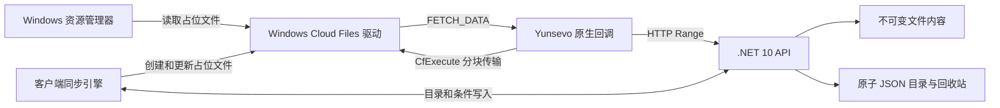

# 实现说明

`Yunsevo.Contracts` 负责公共协议、JSON 源码生成、Windows 兼容路径校验与原子写入。`Yunsevo.Server` 使用 ASP.NET Core Slim Minimal API，内容先流式落盘，元数据在单写锁内检查条件版本，再提交目录。快照发布后不再修改。数据目录由独占锁文件保护，禁止两个进程同时管理。

`Yunsevo.Client` 使用 Win32 原生控件和托盘。Shell 集成通过 Windows SDK 的 WinRT 投影调用 `StorageProviderSyncRootManager`，占位文件由 `CfRegisterSyncRoot` / `CfConnectSyncRoot` / `CfCreatePlaceholders` 管理。Full hydration + AlwaysFull population 表示预先获取全部目录元数据，文件内容仍然按需下载。不是后台下载所有文件。

非托管 FETCH_DATA 回调只复制必要数据，不保存来自 Windows 的借用指针。网络下载在后台完成，通过 `CfExecute(TRANSFER_DATA)` 传输 4 KiB 对齐数据，尾块允许结束在 EOF。请求带文件版本，禁止把其他版本的数据填入旧占位文件。CANCEL_FETCH_DATA 中断网络读取；断开连接后才释放回调上下文。

同步引擎每次获得完整目录，先处理远端移动，再根据占位文件身份识别本地移动，然后处理删除、上传和远端更新。每次云端写入后重新获取快照。服务器用条件版本防止覆盖，并对目录删除校验全局 revision。客户端对上传源持有禁止其他写入/重命名的文件句柄，上传和占位符提交完成后再释放。传给 Cloud Files 同步管理 API 的文件句柄不绑定 .NET 异步 IOCP，避免空 OVERLAPPED 的完成通知破坏运行时。

客户端的 `RemoteDirectory` 是云盘内的逻辑路径，与服务器磁盘上的 `DataPath`、本地的 `SyncRoot` 分开。CloudApi 将上传/新建/移动目标加上此路径前缀，将目录快照过滤到该子树并移除前缀，文件 ID 和全局 revision 保持不变。下载直接使用原 ID；目录删除继续使用全局 revision。不同设备填写同一逻辑路径时复用目录和文件，不以设备或本地目录名创建新的空间。嵌套目录逐层创建，并处理两个客户端并发创建同名目录的竞争。

首次连接会将所选云端目录 ID 持久化，即使目录完全为空也会保存。后续若该名称不存在或已经换成另一个 ID，停止本轮同步，不返回空快照、不自动重建目录，以免误删本地文件。配置文件相邻的 `.profiles` 目录按服务器、云端逻辑路径和本地路径保存独立基线，旧版本匹配的 `.state.json` 继续复用；切换绑定不会把原基线当成另一处本地删除。云端目录是同步范围，不是权限隔离，持有同一 API 密钥的网页仍可管理全部文件。

Windows 的同步根注册与 JSON 状态相互独立。连接前通过 `CfGetSyncRootInfoByPath` 读取实际注册的提供者、根文件 ID 和根身份，比较父目录的根 ID 排除“落在别的同步根内”的子目录；只更新精确匹配的 Yunsevo 根。根身份保存服务器和云端目录的摘要。空的旧 Yunsevo 根允许首次绑定或切换，非空不同绑定保留原文件并拒绝接管；旧版没有根身份的注册也能在空目录恢复。有状态而无注册时执行首次注册。设置窗口在停止旧连接前检查本地目录，注册和 Shell 设置成功后才保存新配置。

网页使用同一套目录、版本条件和回收站接口。登录后每 5 秒在可见页面刷新快照，仅在 revision 变化时重绘；输入名称、上传和执行操作期间暂停自动刷新，切回页面时立即检查。断网显示重试状态，不重复弹出错误提示。

上传读取内容使用只读 FileStream，句柄附带 Cloud Files 所需的 WRITE_DATA 元数据管理权限；遇到只读文件则尝试 WRITE_DAC，不修改 ACL、不移除只读属性。上传前将文件转换为数据完整但尚未同步的占位文件，成功后提交服务器身份并标记 in-sync。失败项目和无法完整扫描的子树被记录、保护并在下一轮重试，其他项目继续；不能把未扫描到的文件误认为本地删除，也不能把部分完成报告为全部同步完成。

Explorer 的传输状态与数据可用性分别处理：通过易失属性存储上报 `System.SyncTransferStatus` 与传输进度，使用 `SHChangeNotify` 刷新，并通过 Windows Search API 将未被索引的同步根纳入缓存范围。只记录并清理客户端自己新增的索引规则。只读文件的 Shell 易失属性存储可能拒绝写入，仍由 Cloud Files 的 not-in-sync/in-sync 状态提供待同步和完成图标，保留文件只读属性。实现参考[微软 CloudMirror 的状态和索引示例](https://github.com/microsoft/Windows-classic-samples/blob/main/Samples/CloudMirror/CloudMirror/Utilities.cpp)。

双方都修改时，在持锁状态下上传并复制本地内容到唯一冲突文件，确认副本落盘后再将原占位文件标记可更新。更新使用 VERIFY_IN_SYNC，期间再次发生写入时保留原内容并等待重试。云端删除遇到尚未上传的本地修改时重新上传保留这些修改。同步和手动固定/释放由同一个客户端异步锁串行执行。

远端更新会使旧缓存失效；被用户固定的文件先临时取消固定、更新，再恢复固定并下载新内容。Explorer 设置的固定状态变化通过同步轮询处理；仅更改固定意图并不等价于内容已经下载。

## 当前边界

- 单用户、单服务器进程；不提供分布式元数据事务。目录 JSON 用于第一版，大目录应迁移到支持 AOT 的存储层和增量变更日志。
- 当前上传是完整文件流，失败后重新上传；下载支持按范围读取。没有跨版本块去重、客户端上传分片、垃圾回收和存储配额。
- 目录全量扫描；一轮最多处理 100 次需要重新取快照的更改，再在下一轮继续。单个文件的访问、占用、类型冲突、无效名称等异常按项目隔离；该项目及涉及它的目录删除/移动受到保护。网络或服务端整体故障仍会暂停该轮并重试。
- 不支持把符号链接、目录联接、其他云盘中的目录或磁盘根目录作为同步树。首次同步必须为空；同步状态与账户目录绑定，不提供自动丢弃状态和重置按钮。
- 普通退出只断开同步，不移除 Explorer 注册。自动登录启动由用户选择；没有安装包激活的“打开占位文件自动唤起客户端”机制，需先运行客户端。
- 仅 Windows x64 做过原生 AOT 和 Cloud Files 实测。资源管理器的具体状态图标、右键菜单和状态刷新取决于 Windows Shell；本项目也提供客户端内明确的固定和释放按钮。
- 密钥通过 Windows 当前用户 DPAPI 保护；这不是服务器文件的端到端加密。远程连接需要 HTTPS，数据目录按服务端账户权限保护。
