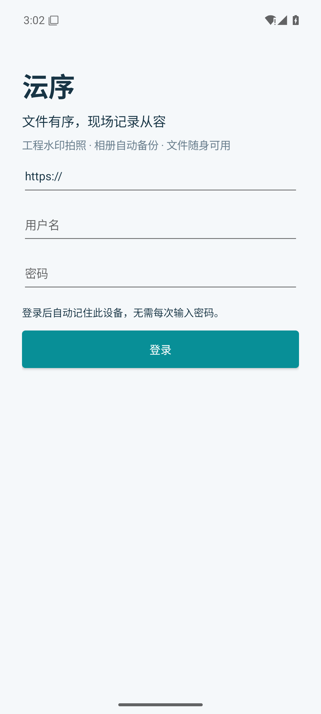
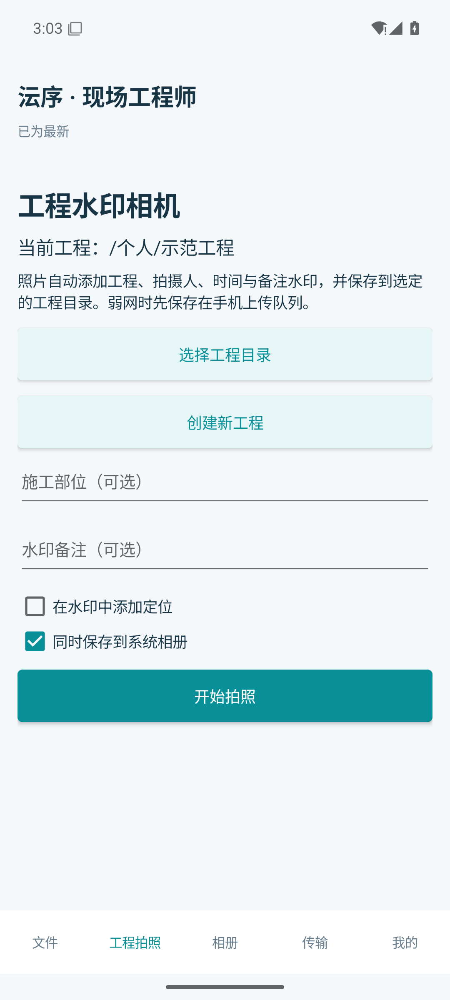
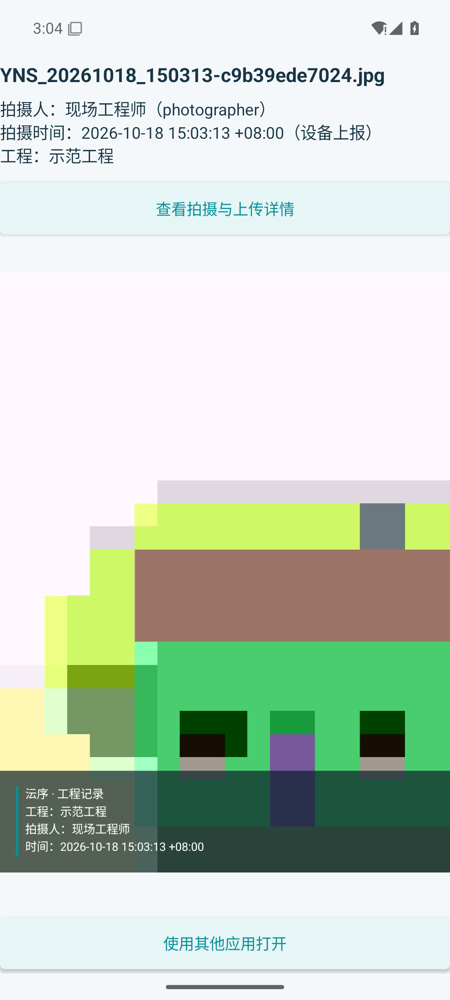
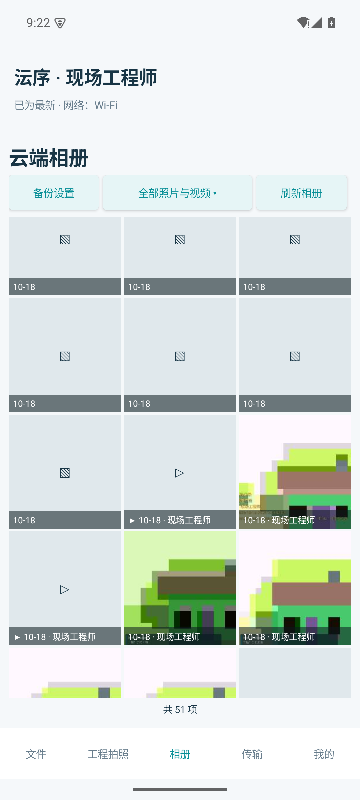
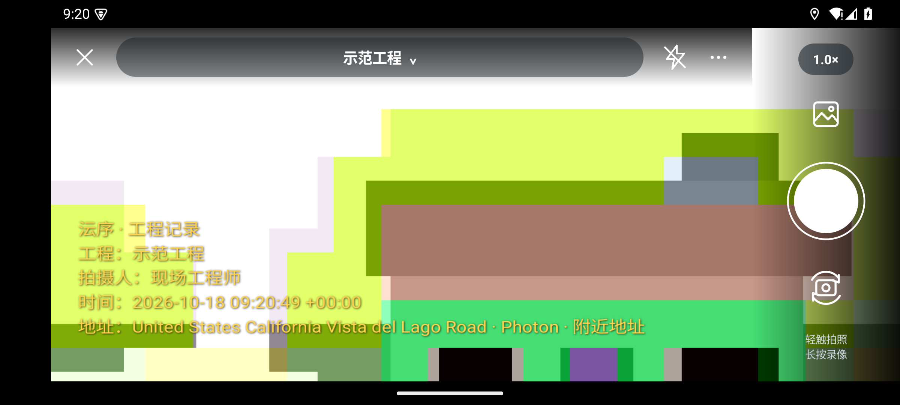

# 沄序 · Android 手机端 1.2

Android 优先实现，采用 .NET 10 原生 Android 界面；登录、队列、上传、相册去重等逻辑位于 MyPan.Mobile.Core，供后续 iPhone 端复用。当前交付不包含 iPhone 安装包。

## 使用流程

1. 先升级到包含手机拍摄来源接口的服务端，使用受信任 HTTPS 地址登录；可信局域网也可直接输入 `http://服务器内网IP:5080`。登录凭据经 Android Keystore 的 AES-GCM 密钥加密保存，下次自动恢复。
2. 在“工程拍照”选择或创建工程目录，设置施工部位、备注、定位、详细地址与天气。保存方式可选“云端＋本机相册”或“仅云端”。水印支持工程卡片、简约文字和横幅记录，可关闭底色、调整字体颜色及大小。
3. 原生 Camera2 全屏取景，轻触对焦、双指缩放，点倍率标识切换 1× / 2×，右侧图标翻转前后摄像头；轻触圆形快门拍照，长按录像，松开结束。点顶部工程名称即可搜索并切换云端工程，已经拍下的文件仍按拍摄时的目录入队。支持横竖屏，横屏操作区移到侧边，录像期间锁定开始时的方向。水印直接写入 JPEG / MP4；声音按麦克风授权和选项录制，更多菜单可调整水印、保存方式和是否允许移动网络上传。拍摄人由服务端根据登录账号填写，项目名称与保存位置由服务端目录解析。
4. “相册”显示有访问权限的云端照片与视频，可按当前工程、备份目录或全部内容查看。照片列表只请求服务端生成的最大边 256 像素缩略图，不会先下载原图；不支持缩略图的格式保留图标，点击后可尝试打开。滚动接近底部时继续加载，使用游标减少新增照片导致的翻页位移，格子循环复用以限制内存占用。进入“备份设置”选择云端目录并开启自动备份，授权照片/视频访问；支持仅 Wi-Fi、包含视频和仅充电时上传。
5. 其他应用分享菜单选择“沄序”，或从文件页面选择手机文件；接收后选择云端保存目录。文件先保存到应用私有收件箱，再进入持久上传队列。
6. 文件页面支持目录浏览、搜索与分页；点文件打开图片、视频、文本预览。图片支持双指缩放、双击放大/还原、放大后拖动，遵循 EXIF 方向；未放大时左右滑动切换同一查看范围内的上一项、下一项。文件名、拍摄信息、保存、分享与信息按钮位于底部，详情以底部面板展开，包含可用 EXIF 参数。可保存到系统相册、另存为或通过系统分享菜单发送。其他类型可授权给外部应用打开。

相册使用保留云端副本的备份方式，手机清理照片不会自动删除已备份云端内容。工程拍摄保存的系统相册副本已由工程队列上传，自动相册扫描跳过 Pictures/Yunsevo 与 Movies/Yunsevo，避免重复备份。仅云端模式仍需在应用私有目录临时落盘，确认云端提交后清理；未上传成功的文件会保留，不能先卸载或清空应用数据。

## 照片参数与位置天气

水印编码后复制原图可用的 EXIF 拍摄信息，包括制造商、机型、光圈、曝光时间、ISO、焦距、曝光补偿和拍摄时间；缺少的曝光信息从本次 Camera2 CaptureResult 补充，机型从设备信息补充，不伪造相机没有提供的数据。处理后更新实际图像尺寸及方向，不复制原图内部偏移指针或 MakerNote 二进制区块。

网页管理员在“服务设置 → 工程拍摄 · 地址与天气”选择服务商、配置高德 **Web 服务** Key、Photon 地址、缓存时长和项目联系网址。Key 在服务端 AES-GCM 加密保存，手机不接收 Key，管理员读取接口只返回是否已配置。迁移备份包含加密设置和解密密钥；恢复脚本会校验这两个文件。

高德查询先将手机 GPS 的 WGS84 坐标转换为 GCJ-02，再查询地址与行政区天气。免费测试可选 Photon 公共演示服务器和 MET Norway；Photon 公共实例需控制请求量，生产可自建；MET 数据按 CC BY 4.0 标明来源，展示为预报并保留数据时间。服务器统一缓存、限制请求频率并标识 User-Agent，手机仅在相机页面启用相应选项时查询。

查询会向所选服务商发送定位坐标。无权限、无定位、服务关闭、断网或天气过期时，水印明确显示等待定位或暂不可用；不会使用虚假地址与天气。地址精度取决于手机授权、定位结果及地图数据。天气、地址和设备时间仍是拍摄附加信息，不构成真实性鉴定。

服务文档：[高德逆地理编码](https://lbs.amap.com/api/webservice/guide/api/georegeo)、[高德天气](https://lbs.amap.com/api/webservice/guide/api/weatherinfo)、[Photon](https://github.com/komoot/photon#demo-server)、[MET 服务条款](https://api.met.no/doc/TermsOfService)、[MET 授权](https://api.met.no/doc/License)。

## 上传与恢复

队列按服务地址和用户 ID 隔离；切换账号后不会把原账号的待上传文件发到新账号。权限撤销、配额不足、网络中断和会话失效都会保留待上传内容，修复后从“传输”重试。

接收和备份使用流式私有暂存，上传复用已有分块续传与 SHA-256 校验。收到云端提交后才清除私有缓存；提交响应丢失时用拍摄编号、长度及内容哈希确认既有文件，避免覆盖或重复创建。

拍摄草稿与最终 JPEG / MP4 先落盘；新进程可将已完成的照片或视频恢复到队列，未完成处理的当前拍摄不会被后台任务抢先搬走。录制尚未封装完成的 MP4 临时文件不会被当作有效视频上传。

“仅 Wi-Fi”按当前网络传输类型判断，支持经过 Wi-Fi 的 VPN；不会把 VPN 的计费标记当作移动网络。切换网络后自动重新检查队列，首页显示 Wi-Fi、移动网络或离线及 VPN 状态。VPN 同时使用 Wi-Fi 与移动网络或未披露底层类型时，保持等待，避免意外消耗流量。

Android 使用系统 JobScheduler 周期任务、应用运行时的媒体变更监听和前台触发。后台执行时机由系统根据网络、充电和省电策略调度；强制停止应用后需重新打开才能恢复系统任务。Android 14 仅授权选中照片时，自动备份范围相应受限。定位仅在拍照页按授权获取，不能定位时不生成虚假坐标。

录像将相机帧时间映射到编码器的单调时钟，避免部分设备休眠累计时间导致音视频错位和虚假的超长时长；每段录像重置映射，保存前校验时长。相机 JPEG 数据复制后显式关闭 ImageReader 图像，支持连续拍摄而不耗尽缓冲区。

当前视频预览先下载到应用私有缓存再播放，尚非边下边播；图片缩采样、文本最多显示前 1 MiB。HEIC 等格式取决于系统解码器，其他格式可由外部应用打开。

服务端缩略图使用 SkiaSharp，发布目录包含对应平台的本机图像库和授权说明，部署时需复制完整目录。缩略图缓存按文件 ID 和版本隔离，读取缓存同样验证权限；生成任务限制并发，服务端派生缓存约束在 512 MiB，手机缩略图缓存约束在 128 MiB。派生缓存不进入迁移备份，恢复后按需生成；原始文件和历史版本不受影响。

## 构建

需要 SDK 10.0.402、.NET Android 工作负载、Android SDK 36 和 JDK 21。主解决方案不依赖 Android 工作负载；手机端另用 MyPan.Mobile.slnx。

~~~powershell
dotnet workload install android
./scripts/publish-android.ps1 -Runtime android-arm64 -AndroidSdk '你的SDK目录' -JavaSdk '你的JDK目录'
~~~

产物在 artifacts/mobile/android-arm64/yunsevo-android-arm64.apk，适用于 Android 8.0 及以上 ARM64 设备。android-x64 为模拟器/对应架构测试包，不是 ARM 手机包。

Release 启用 Mono AOT，并关闭仅针对配置文件的 AOT；这与服务端/桌面的 Native AOT 不同。Android NativeAOT 在 .NET 10 中仍为实验能力，因此本客户端采用已支持的 Mono AOT。

默认构建使用 .NET Android 开发签名，只适合内部测试。正式分发请提供 SigningKeyStore、SigningKeyAlias，并通过 YUNSEVO_ANDROID_STORE_PASSWORD 和 YUNSEVO_ANDROID_KEY_PASSWORD 环境变量传入密码；不要上传密钥库，后续升级需沿用同一签名。

## 服务端数据

CloudEntry 新增可选 origin，历史数据可继续读取；当前内容、历史版本和回收站均保留相应来源。恢复历史版本时也恢复其拍摄信息。

小文件通过 X-MyPan-Photo 发送 Base64 UTF-8 JSON，大文件在 StartUpload.Metadata 中携带相同结构。服务端验证项目目录和权限，并从认证身份生成 photographer/uploadedBy；客户端上报的同名身份字段不被采信。时间、位置、设备名称属于设备上报信息，上传时间及用户身份由服务端记录。

原生 AOT 集成检查使用 tests/MyPan.MobileTests；Android 实际流程脚本 tests/android-smoke.mjs 仅允许 emulator-* 设备，会清空测试模拟器中的该 App 数据，不可用于实际手机。实际验证范围、截图及报告在 artifacts/mobile 下汇总。

## 界面与验证范围

下面是 Android 15 x64 模拟器中实际运行的 Release AOT 界面，使用隔离演示账号与虚拟相机画面。工程拍照生成的水印已经写入 JPEG，不依赖预览时叠加。

| 登录 | 工程目录 |
| --- | --- |
|  |  |

| 工程水印相机 | 云端照片与拍摄人 |
| --- | --- |
|  |  |

| 连续滚动的云端相册 | 横屏工程相机 |
| --- | --- |
|  |  |

原生服务端与共享手机核心的集成检查包含分块续传、身份来源、版本恢复、相册去重、拍摄中断恢复、视频草稿、云端相册权限与账号切换隔离。tests/environment-smoke.mjs 使用本地模拟服务验证地址查询、缓存和失败处理，无需真实 Key。tests/android-smoke.mjs 验证实际 Camera2 照片、成片 EXIF、长按录像、云端相册、保存与分享。每次交付的实际检查数、构建哈希和截图见 artifacts/mobile/verification.json。

ARM64 包已在 Android 16 真机安装并确认登录界面正常启动。真机的相机兼容性、相册权限和厂商后台省电策略仍需结合实际使用验证；当前安装包为开发签名，未作为正式商用签名发布。iPhone 端尚未提供。

参考：[.NET Android 构建属性](https://learn.microsoft.com/dotnet/android/building-apps/build-properties)、[.NET 移动运行时与编译](https://learn.microsoft.com/dotnet/maui/deployment/runtimes-compilation?view=net-maui-10.0)、[Android 照片访问权限](https://developer.android.com/about/versions/14/changes/partial-photo-video-access)、[Android JobScheduler](https://developer.android.com/reference/android/app/job/JobInfo.Builder)。

## 三维扫描（Android 1.3 试验版）

在“工程拍摄”点击“三维扫描”，选择云端目录并添加系统相册原片或引导绕拍。支持本机 Vulkan／CPU 和服务端生成，生成的 GLB 在手机与网页可旋转、缩放、分享和下载。构建顺序、运行库、数据恢复与当前质量边界见[三维扫描说明](reconstruction.md)。

Android 1.3.1 新增环绕录像采集、视频自动选帧和取景网格。请移动绕物体拍摄，原地旋转不具备恢复深度所需的视差。源视频保留在应用私有扫描目录，选取照片可继续本机／云端重建，详见 [三维扫描说明](reconstruction.md#视频环绕采集)。

Android 1.3.2：三维模型改用原照片投影贴图，支持精细模式和保留旧模型后重新生成。退出登录先清除本机凭据，即使断网也可立即退出；联网时尽力注销服务器令牌，最多等待两秒。离线时服务器令牌无法立即撤销，但本机不再保存或使用它。待上传文件按原账号保留，重新登录该账号可继续。登录页和“我的”页提供“关闭应用”以关闭界面；保持登录时，用户已启用的后台备份仍可继续。

局域网手机测试：服务端默认 HTTP 监听全部 IPv4 网卡的 5080 端口，手机直接输入 `http://服务器内网IP:5080`，例如 `http://192.168.1.8:5080`，无需 ADB 转发。HTTP 支持本机、IPv4 私网/链路本地地址、IPv6 ULA/链路本地地址，须使用 IP 地址；公网与域名地址要求受信任 HTTPS。客户端逐请求检查地址并禁止自动重定向。HTTP 不加密，仅用于可信内网；当前测试服务器没有启用 HTTPS。

Android 1.3.3 新增局域网 IP 的 HTTP 直连；登录表单支持由连接入口预填服务器和用户名，不接收密码或令牌参数，也不会自动执行登录。

Android 1.3.4 改进手持视频的相机定位、中心物体对焦与选帧、录像焦距标定、CPU／Vulkan 深度估计，以及居中物体范围重建。支持正常倾斜和起伏，不要求水平绕行；透明或反光表面仍可能缺面。定位失败会用中文解释已定位数量和补拍建议，原片与源视频保留。详见[算法和验收边界](reconstruction.md#手持与视频定位改进134)。
