# 沄序 · 界面截图

以下均为当前程序在隔离测试环境实际运行的截图，使用演示账号和文件，不含正式云盘数据或密钥。任务管理示例来自 Windows Native AOT 客户端；页末另列出 v2.6.2 全部六个平台的原生登录窗口截图。各系统共用 Avalonia 界面，字体、窗口和托盘表现可能不同。

## 桌面客户端

### 多服务器与同步任务

按服务器分组管理任务，每个任务独立选择云端目录、本地目录和下载方式。

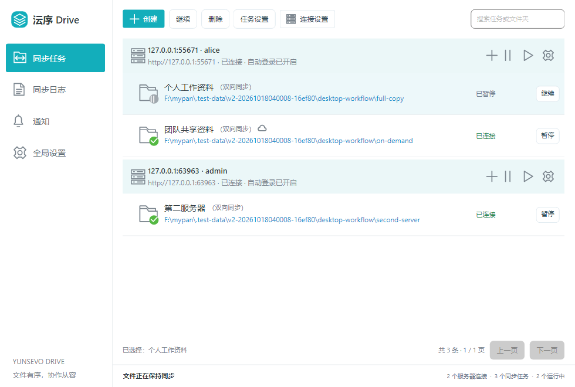

### 登录

首次登录后加密保存设备会话，下次启动自动恢复。

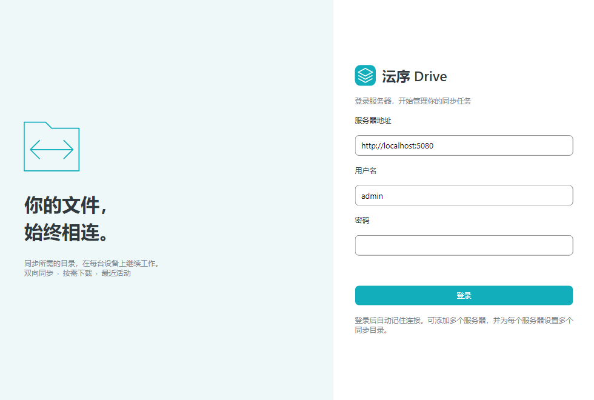

### 创建同步任务

选择授权的云端目录、本地同步位置以及按需下载或完整下载。

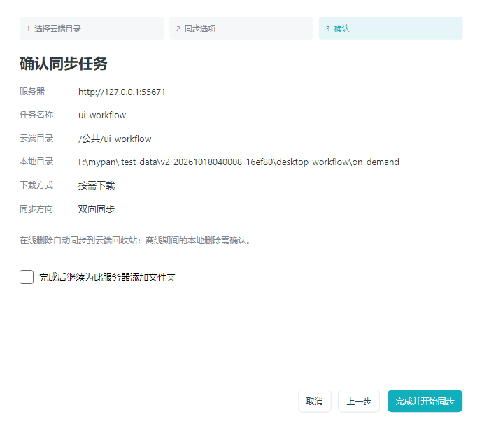

### 托盘与最近更改

单击托盘图标打开状态面板，查看最近文件活动，快速进入文件夹、网页或任务管理。

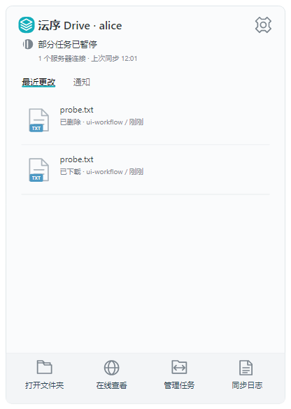

### 同步日志与用量

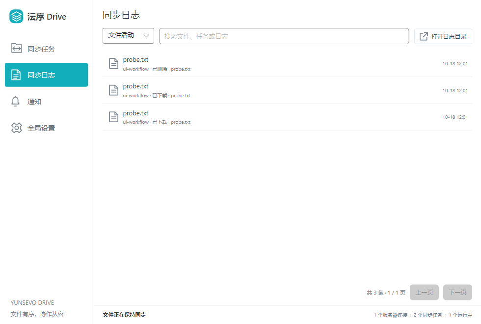

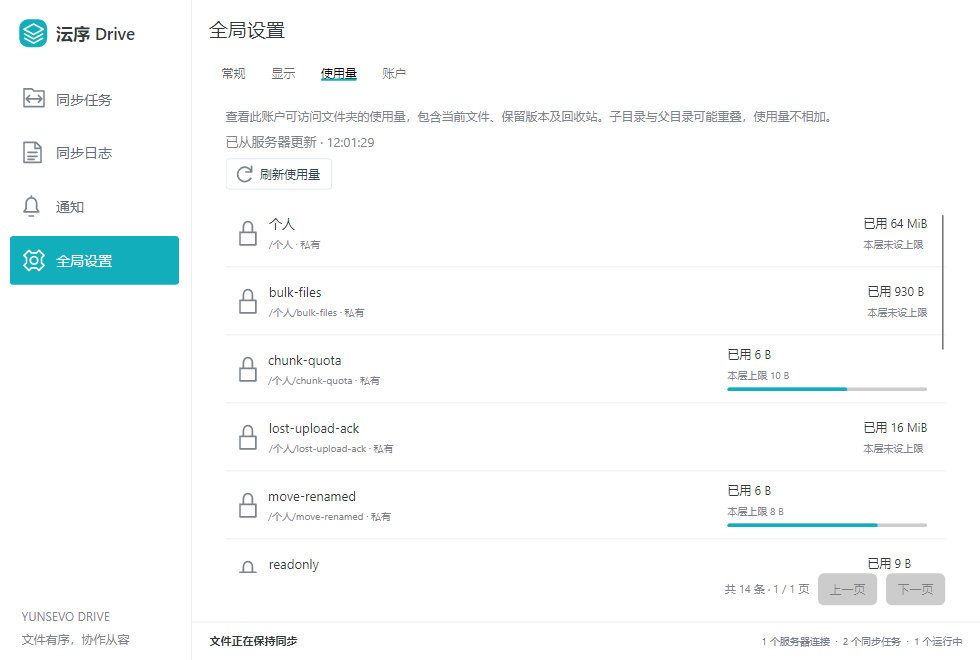

## 服务端网页

### 登录与客户端下载

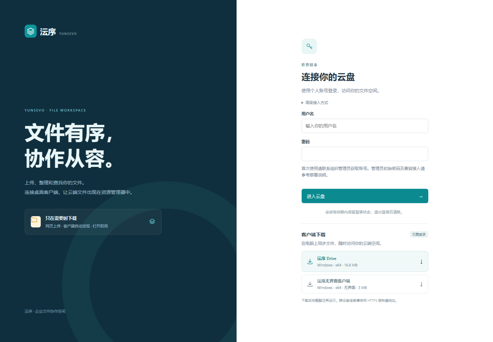

### 文件管理

浏览文件夹、上传、下载、预览及管理文件版本。

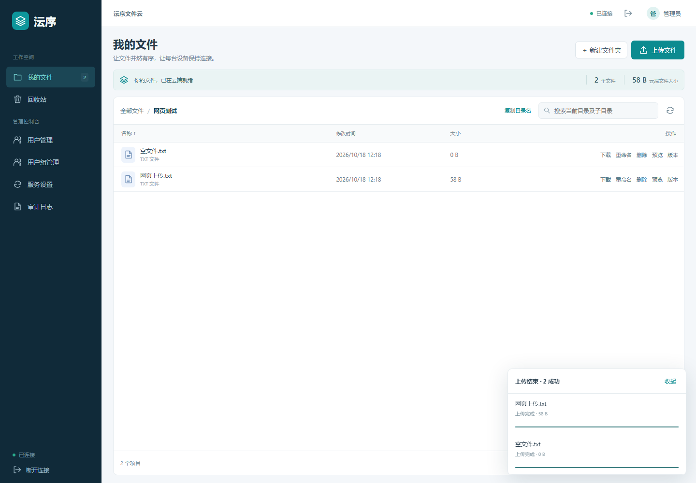

### 用户管理

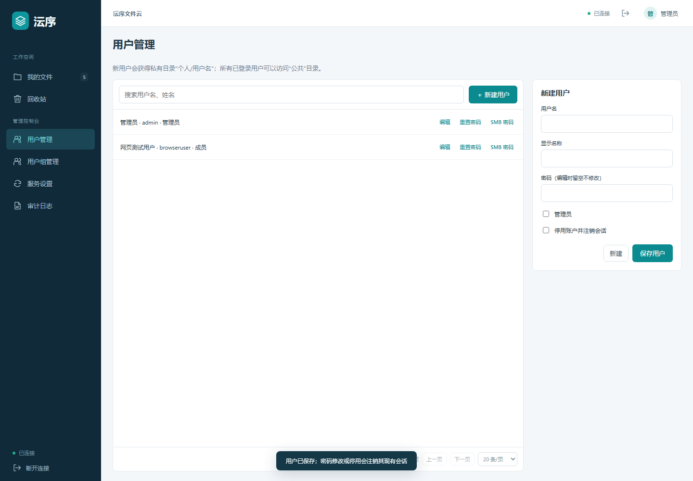

### 文件夹权限、配额和版本保留

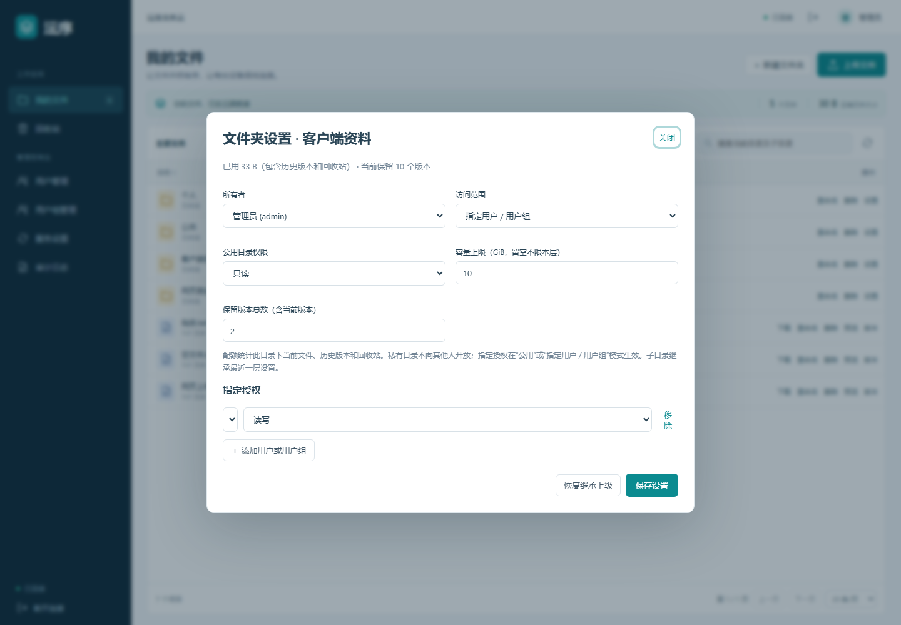

### 回收站与删除来源

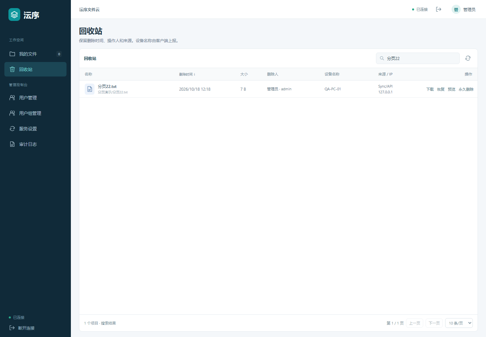

### 服务设置与迁移备份

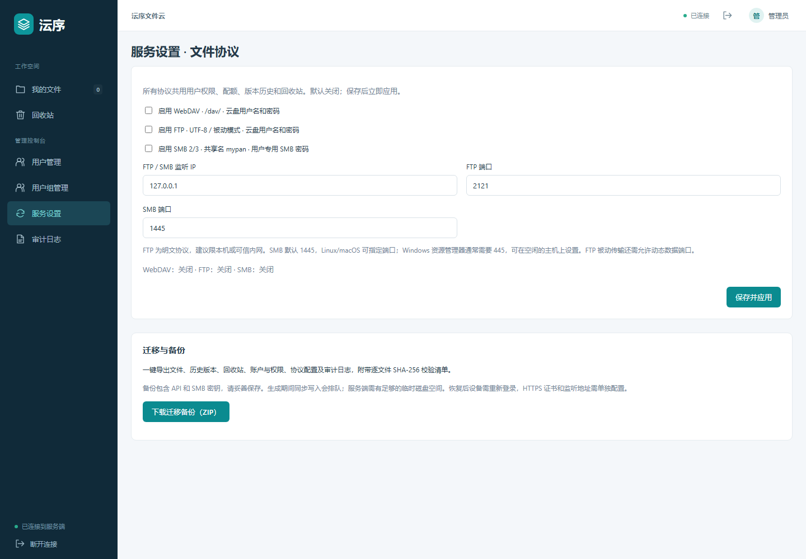

### 审计日志

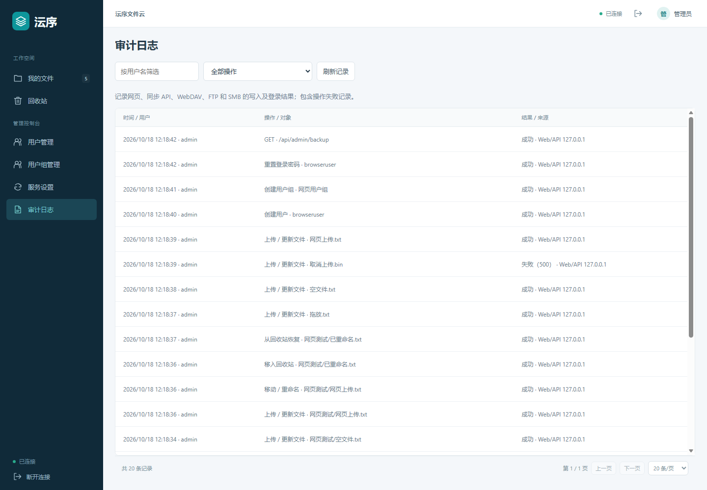

## 六个平台的原生窗口

以下截图由 GitHub Actions 在对应操作系统上，从最终压缩包解压运行 Native AOT 客户端后生成，已与 Release 的 SHA-256 清单核对。各平台均通过 12 项启动、登录、文件传输、同步和窗口渲染检查；完整桌面交互与托盘定位仍需各环境验收。

| 系统 | x64 / Intel | ARM64 / Apple Silicon |
| --- | --- | --- |
| Windows | [实际截图](screenshots/desktop-win-x64.png) | [实际截图](screenshots/desktop-win-arm64.png) |
| Linux | [实际截图](screenshots/desktop-linux-x64.png) | [实际截图](screenshots/desktop-linux-arm64.png) |
| macOS | [实际截图](screenshots/desktop-osx-x64.png) | [实际截图](screenshots/desktop-osx-arm64.png) |

### Linux

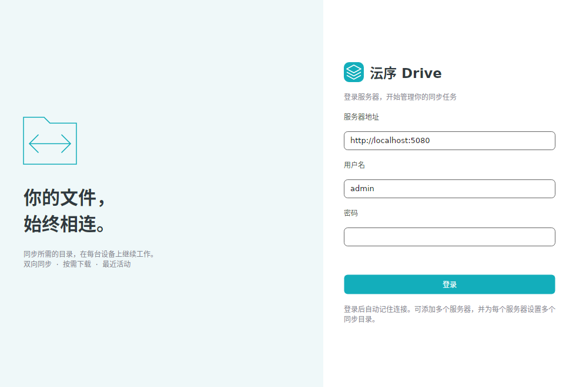

### macOS

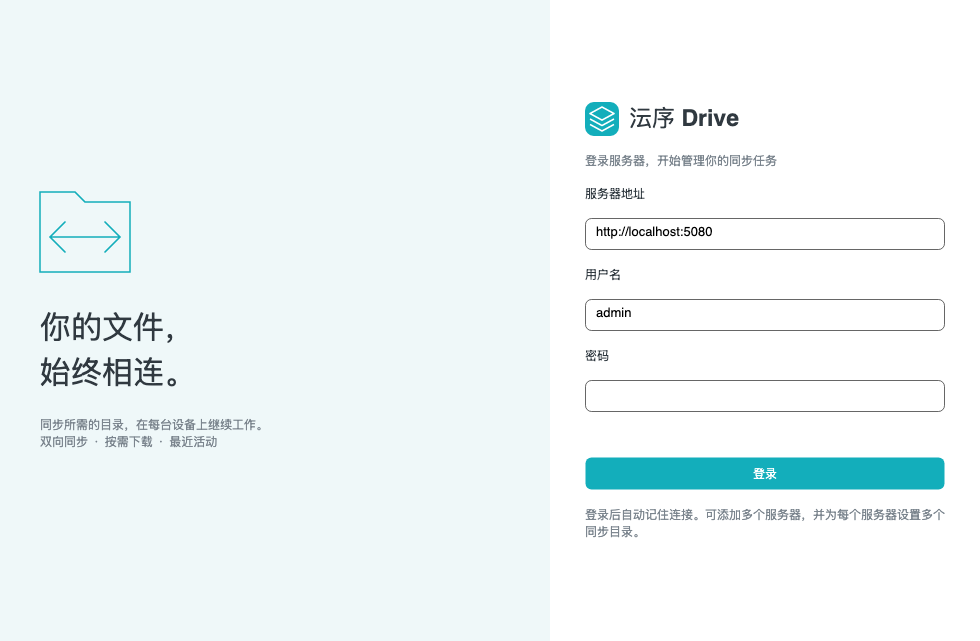

## 3D 模型查看

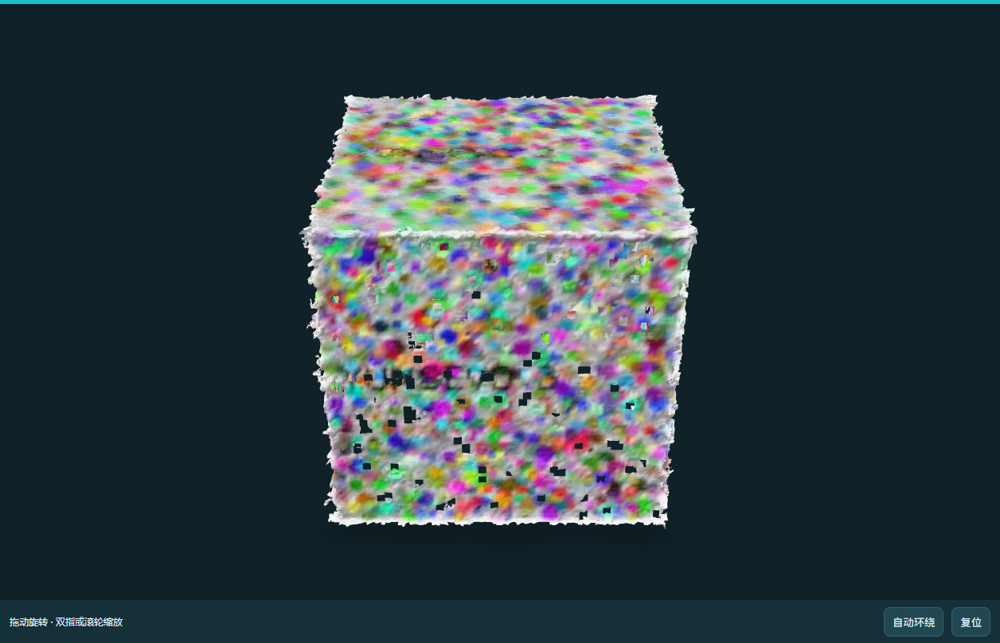
